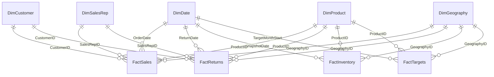

# FreshFlow Foods — FMCG Sales & Operations Analytics (Power BI)

> **Portfolio project | Power BI Desktop · Power Query · DAX · Data Modelling · Business Intelligence**
>
> FreshFlow Foods is a fictional Indian FMCG and dairy distribution company. All data in this repository is synthetic and created for learning and portfolio demonstration; it does not describe a real company or real customers.

## Project at a glance

This project builds a company-level Power BI reporting solution for sales, profitability, customers, products, territories, returns, inventory and sales targets. The goal is not only to display KPIs, but to turn operational data into useful management decisions.

**Current status:** The nine-table model has been imported and modelled, and a first draft of the Executive Sales Overview page has been created. Additional report pages, full measure validation, final visual QA, publishing and the final management recommendations are still in progress.

## Current dashboard preview


*This is a screenshot of the current working draft, not the final validated report. The category chart, channel share values, date filtering and KPI labels still need a final validation pass. The screenshot is included to show project progress transparently.*

## Business problem statement

FreshFlow Foods operates across multiple Indian territories and sells a portfolio of dairy and FMCG products through different customer channels. Management needs a consistent way to understand sales performance, profitability, target achievement, customer contribution, product returns and inventory availability.

Operational information is spread across separate transaction and reference tables. Without a well-designed data model and standardised measures, management may struggle to compare regions, identify profitable products, understand return patterns, spot stock risk or distinguish a genuine performance change from a data-quality issue.

**The business problem:** Build an interactive Power BI solution that consolidates the company's synthetic operational data, applies repeatable cleaning and modelling rules, defines trusted KPIs, and presents analysis that helps management identify performance gaps and prioritise actions.

## Business questions

1. What are Gross Sales, Net Sales, Gross Profit, Gross Margin, units sold, orders and Average Order Value?
2. Which product categories, brands and SKUs generate the most revenue and profit?
3. Which regions, territories and sales representatives perform best against targets?
4. Which customer types, channels and segments contribute most to sales?
5. What are the return volumes, refund amounts and leading return reasons?
6. Which product-territory combinations are below reorder levels?
7. How do sales and profitability change by month, quarter and year?
8. How do discounts relate to revenue and gross margin?

## Project objectives

- Import and profile nine separate CSV tables.
- Clean and standardise the source data in Power Query, documenting important decisions.
- Build a star-schema-style model with dimensions filtering the relevant fact tables.
- Create reusable DAX measures with explicit business definitions.
- Build an interactive executive report and supporting analytical pages.
- Validate totals, date behaviour, relationships and visual interactions.
- Communicate quantified findings and practical recommendations.
- Publish the PBIX, documentation, data dictionary and screenshots in a GitHub repository.

## Dataset overview

The dataset covers **1 January 2024 to 31 December 2025**. The source CSV files are stored in [`data/raw/`](data/raw/). The counts below describe the supplied raw files, before Power Query cleanup.

| Table | Type | Raw rows | Grain |
|---|---|---:|---|
| `FactSales` | Fact | 18,120 | One order line; includes 120 exact duplicate source rows for cleaning practice |
| `FactReturns` | Fact | 805 | One return event / partial return line |
| `FactInventory` | Fact | 13,824 | One month-end snapshot per product and geography |
| `FactTargets` | Fact | 13,824 | One monthly target per product and geography |
| `DimProduct` | Dimension | 72 | One product / SKU |
| `DimCustomer` | Dimension | 1,000 | One customer / buying account |
| `DimGeography` | Dimension | 8 | One sales / distribution territory |
| `DimSalesRep` | Dimension | 48 | One sales representative |
| `DimDate` | Dimension | 731 | One calendar date |
| **Total** | | **48,432** | |

See [`docs/DATA_DICTIONARY.csv`](docs/DATA_DICTIONARY.csv) for column-level definitions and [`docs/Original_Project_Brief.md`](docs/Original_Project_Brief.md) for the original dataset brief.

## Data model

The model uses four fact tables and five dimensions. Dimension keys should be unique. Relationships should normally be one-to-many, single-direction from dimension to fact. Confirm the actual relationships in the PBIX Model view before treating the model as final.



**Important modelling notes**

- Do not create a direct relationship between `FactSales` and `FactReturns`. `SalesLineID` in returns is retained for traceability; the two facts have different grains.
- Remove the 120 duplicate sales rows using `FactSales[SalesLineID]` as the uniqueness key. Expected cleaned FactSales row count: **18,000**.
- Do not deduplicate `FactReturns` by `SalesLineID`: multiple return events for one sales line may be legitimate. `ReturnID` identifies the return event.
- Inventory is a snapshot. Do not sum month-end closing stock across all months to report current stock; use the appropriate latest snapshot logic.
- Targets are monthly, stored on the first day of each month. Compare targets and actuals at matching month/product/geography context.
- Date roles differ: sales use `OrderDate`, returns use `ReturnDate`, inventory uses `SnapshotDate`, and targets use `TargetMonthStart`. Explain the date basis of any combined metric.

See [`docs/Relationship_Blueprint.md`](docs/Relationship_Blueprint.md).

## Power Query: preparation and quality checks

The source data intentionally includes data-quality items for practice:

- 120 exact duplicate rows in `FactSales`.
- Blank or inconsistent text values in selected `FactSales` fields.
- A lower-case / padded `OrderStatus` variant.
- Padded or inconsistent labels in `DimCustomer`.
- Blank and padded `ReturnReason` values in `FactReturns`.

The cleanup workflow is: inspect headers → set data types → profile columns → identify duplicates at the correct grain → inspect and resolve errors → handle nulls → trim/clean/standardise text → validate dates and numeric values → remove irrelevant fields only when justified → reconcile row counts and keys. Record the exact steps applied in Power Query; do not claim a problem was removed unless the PBIX query steps confirm it.

## KPI definitions

| KPI | Definition |
|---|---|
| Gross Sales | Sum of `Quantity × UnitPrice` across sales lines |
| Discount Amount | Sum of `Quantity × UnitPrice × DiscountPct` |
| Net Sales | Gross Sales − Discount Amount; excludes tax and freight |
| COGS | Sum of `Quantity × UnitCostAtSale` |
| Gross Profit | Net Sales − COGS |
| Gross Margin % | Gross Profit ÷ Net Sales |
| Orders | Distinct count of `OrderID` |
| Units Sold | Sum of `Quantity` |
| Refund Amount | Sum of `FactReturns[RefundAmount]` |
| Returned Units | Sum of `FactReturns[ReturnQty]` |
| Target Achievement % | Actual Net Sales ÷ Sales Target Amount, evaluated at matching target grain |

KPI definitions and starter DAX are documented in [`docs/DAX_Measures_Starter.md`](docs/DAX_Measures_Starter.md).

## Planned report pages

| Page | Purpose | Status |
|---|---|---|
| Executive Sales Overview | Revenue, profit, margin, orders, regional and channel/category/product mix | First draft created; validation and formatting pending |
| Product & Margin Analysis | Product, brand, category and SKU performance | Planned |
| Customer & Sales Rep Performance | Segments, channels, account and representative performance | Planned |
| Returns & Quality | Refunds, return rates/reasons and disposition | Planned |
| Inventory & Supply | Latest stock, reorder risk and stock status | Planned |
| Targets & Territory | Target attainment by month, product and geography | Planned |
| Management Insights | Evidence-based findings and recommended actions | Planned |

## Tools and skills demonstrated

- Power BI Desktop
- Power Query Editor (data import, cleaning and transformation)
- Data modelling and relationships
- DAX measures and time intelligence
- Report visualisation, slicers and interactive filtering
- Data validation and business KPI design
- Git and GitHub documentation / portfolio publishing

## Repository structure

```text
FreshFlow-Foods-PowerBI/
├── README.md
├── .gitignore
├── data/
│   └── raw/                 # Original synthetic CSV source files
├── docs/
│   ├── Business_Problem_Statement.md
│   ├── Project_Scope_and_KPIs.md
│   ├── Data_Model_and_Relationships.md
│   ├── Power_Query_Cleaning_Log_Template.md
│   ├── DAX_Measures_Starter.md
│   ├── Dashboard_Status_and_QA.md
│   ├── GitHub_Upload_Guide.md
│   ├── DATA_DICTIONARY.csv
│   └── Relationship_Blueprint.md
├── powerbi/
│   └── README.md            # Put your .pbix file in this folder
└── screenshots/
    └── 01_executive_sales_overview_working_draft.png
```

## How to reproduce the project

1. Download or clone this repository.
2. Open Power BI Desktop and import the CSV files in `data/raw/`.
3. Use Transform Data to inspect and clean the source tables.
4. Build the relationships described in the model documentation, validating keys and cardinality.
5. Create and validate the DAX measures from the DAX starter guide.
6. Build report pages and test slicers, cross-filtering, date filtering and totals.
7. Save the Power BI report as a `.pbix` file under `powerbi/`.
8. Replace the working-draft screenshot with final screenshots as the report is validated.

## Validation backlog before calling the dashboard final

The screenshot currently included is a work-in-progress capture. The following items were visible or reported during development and should be checked before portfolio sign-off:

- Validate that selecting 2024 / 2025 in the Year slicer filters sales correctly through `DimDate`.
- Investigate the channel donut labels: the draft displays repeated equal 20% labels; confirm the visual uses Channel as category and Net Sales as value, and that relationships/filtering are correct.
- Investigate the category chart: the draft shows one category only; confirm the field, visual filters and relationship to `DimProduct`.
- Improve KPI titles; the draft contains automatic “by Date” labels that should be replaced with business-readable titles.
- Reconcile card totals to independently calculated or source-level control totals after cleaning.
- Confirm all slicers interact with the intended visuals and that no visual-level/page-level filters are accidentally restricting results.

## Portfolio and data disclaimer

This is a synthetic educational project. Names, customers, territories, products, transactions and financial values are fictional. Do not represent the results as actual company performance. No real customer or commercially sensitive information is included.

## Author
UDAY GARG
